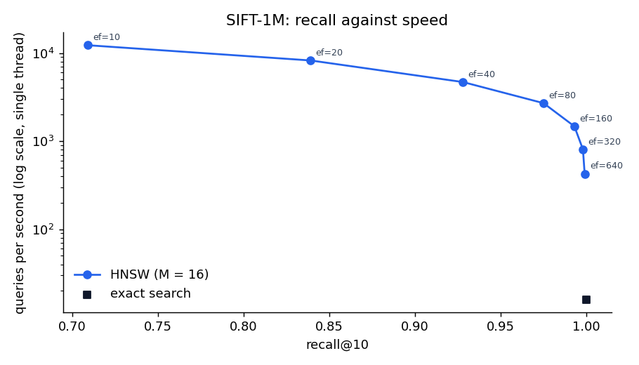

# vectordb

A vector database written from scratch in Java: an HNSW approximate nearest-neighbour index,
a write-ahead log for durability, and leader–follower replication, measured against exact search
on standard ANN benchmarks.

It exists to answer, with numbers, the questions a production vector store has to answer:
how much recall do you give up for how much speed, what survives a crash, and what happens to
writes when a node dies.

> **Status:** milestones 1-3 of 6 done. On SIFT-1M (1,000,000 vectors) the HNSW index reaches
> recall@10 of 0.975 at 169x the speed of exact search, and 0.993 at 92x, on a single thread.
> Durability and replication are next. Benchmark numbers below come only from real runs.

## Build

Requires JDK 21 or newer. The Gradle wrapper downloads Gradle itself.

```bash
./gradlew build      # compile, run tests
./gradlew test       # tests only
./gradlew sweep      # recall and speed of HNSW against exact search
scripts/download_sift.sh   # SIFT-1M into data/sift (160 MB download)
./gradlew sift             # SIFT-1M benchmark, about 15 minutes; -Pn=100000 for a quick subset
```

## Design

| Piece | Choice | Why |
|---|---|---|
| Exact search | `FlatIndex`: one packed `float[]`, bounded max-heap of size k | Ground truth for recall; the baseline HNSW must beat on latency |
| ANN index | `HnswIndex` (Malkov & Yashunin, 2018) | State of the art for in-memory ANN; the same family used in Lucene, FAISS and pgvector |
| Metrics | `L2` (squared), `COSINE`, `DOT`, all "smaller is closer" | One ordering rule for every index |
| Determinism | Seeded level assignment, ties broken by id | Reproducible tests and benchmarks |
| Durability (M4) | Append-only WAL with CRC32 per record, periodic snapshots | Crash recovery without rebuilding the graph from scratch |
| Replication (M6) | WAL shipping from leader to followers | Simple, testable; Raft is the stretch goal |

## Milestones

| # | Weeks | Goal | Done when |
|---|---|---|---|
| 1 | 1 | **Exact baseline.** `Distance`, `FlatIndex`, `Recall`, CI on JDK 21 and 25 | ✅ tests green (CI runs on JDK 21 and 25) |
| 2 | 2–3 | **HNSW in memory.** Insert (Alg. 1), layer search (Alg. 2), neighbour heuristic (Alg. 4), k-NN search (Alg. 5) | ✅ recall@10 ≥ 0.90 test passing (0.993 at `efSearch` 100) |
| 3 | 4 | **Benchmarks.** Load SIFT-1M (`.fvecs`/`.ivecs`), recall-vs-QPS curve across `efSearch`, latency, build time and memory | ✅ SIFT-1M table and plot below. GloVe-100 and JMH distance kernels moved to the stretch goals |
| 4 | 5 | **Durability.** WAL (append, fsync policy, CRC), snapshot + replay, deletes via tombstones | Test that kills the process mid-write and recovers every acknowledged write |
| 5 | 6 | **Service.** gRPC or HTTP API (collections, upsert, search, delete), read–write locking, Dockerfile | `docker run` + client example in README; concurrent read/write test |
| 6 | 7–8 | **Replication.** Leader ships WAL to followers, follower catch-up, manual failover; Docker Compose cluster | Failure test: kill the leader, promote a follower, no acknowledged write lost |

Stretch: SIMD distance kernels with the Java Vector API (benchmarked with JMH), multi-threaded
builds, GloVe-100 for angular distance, product quantisation, Raft, and plugging this in as a
retriever backend for [rag-retrieval-bench](https://github.com/Agampal007/rag-retrieval-bench).

## Benchmarks

### SIFT-1M

[SIFT-1M](http://corpus-texmex.irisa.fr/) is a standard ANN benchmark: 1,000,000 128-dimensional
image descriptors, 10,000 query vectors, and the exact 100 nearest neighbours of each query. Recall
is measured against those published neighbours. Exact search scores 1.000 against them, which also
checks the file reader and the distance code.

Run on a laptop (Intel Core Ultra 9 275HX, 64 GB RAM, JDK 25), single-threaded for both building
and querying, `M` = 16, `efConstruction` = 200, k = 10. Full output: `results/sift-1m.txt`.

- **Build:** 742 s (12.4 minutes) for 1,000,000 inserts.
- **Heap:** 1.52 GB with both the HNSW index and the exact index loaded (each holds its own copy of
  the 512 MB of vectors).

| Index | efSearch | Recall@10 | Queries/s | p50 latency (ms) | p99 latency (ms) |
| --- | --- | --- | --- | --- | --- |
| Exact (FlatIndex) | - | 1.000 | 16 | 56.9 | 94.4 |
| HNSW | 10 | 0.709 | 12,254 | 0.076 | 0.179 |
| HNSW | 20 | 0.839 | 8,232 | 0.116 | 0.226 |
| HNSW | 40 | 0.928 | 4,681 | 0.207 | 0.422 |
| HNSW | 80 | 0.975 | 2,697 | 0.363 | 0.644 |
| HNSW | 160 | 0.993 | 1,473 | 0.671 | 1.210 |
| HNSW | 320 | 0.998 | 806 | 1.235 | 2.194 |
| HNSW | 640 | 0.999 | 426 | 2.302 | 4.397 |



What it shows:

- **At a million vectors the graph pays off.** At recall 0.975 HNSW answers 169 times as many
  queries per second as a full scan (2,697 against 16), and at 0.993 it is still 92 times faster.
  The p99 latency at `efSearch` 80 is 0.64 ms against 94 ms. At 10,000 vectors (below) the same
  index was only 1.7-3.2 times faster, because a small scan is cheap.
- **The last per cent of recall is the expensive part.** Going from 0.975 to 0.993 halves the
  throughput, and 0.998 to 0.999 halves it again.
- **This is a plain Java implementation.** Distances are scalar loops (no SIMD), and the build is
  single-threaded, so optimised C++ libraries are faster. The stretch goals target both.

Caveats: one run on one machine; timings from `System.nanoTime()` around each query after a
warm-up, not JMH. Exact-search speed is timed on the first 200 queries; HNSW on all 10,000.

### First check: 10,000 random vectors

Output of `./gradlew sweep`: 10,000 uniform random 32-dimensional vectors, 200 queries, k = 10,
L2, `M` = 16, `efConstruction` = 200. Single-threaded on a laptop with an Intel Core Ultra 9 275HX,
JDK 25. HNSW build took 1.9 s.

| Index | efSearch | Recall@10 | Queries/s |
| --- | --- | --- | --- |
| Exact (FlatIndex) | - | 1.000 | 6,591 |
| HNSW | 10 | 0.596 | 98,037 |
| HNSW | 20 | 0.786 | 50,512 |
| HNSW | 50 | 0.945 | 21,292 |
| HNSW | 100 | 0.993 | 11,354 |
| HNSW | 200 | 1.000 | 5,691 |

What it shows:

- **`efSearch` is the recall/speed dial.** Each doubling roughly halves throughput, and recall
  climbs from 0.596 to 1.000 across the range.
- **At this size HNSW wins only modestly.** At recall 0.945 it is 3.2x faster than a full scan;
  at 0.993, 1.7x. A scan of 10,000 vectors is cheap, so the gap grows with the dataset (see
  SIFT-1M above).
- **Random data is a hard case.** Uniform vectors in 32 dimensions have no clusters for the graph
  to exploit, so real embeddings usually reach the same recall at a lower `efSearch`.

Caveats: one dataset and size, one seed, timings from `System.nanoTime()` after a warm-up rather
than JMH, and the numbers vary by a few per cent between runs.

### Known limitation: many exact duplicates

When hundreds of vectors are identical, the early copies fill their link lists and ties keep the
older links, so later copies get no inbound links. In a test with 300 identical vectors, 34 were
reachable. Search still returns exact matches, but not every copy. Deduplicate upstream if this
matters.

## Layout

```
src/main/java/io/github/agampal007/vectordb/
  Distance.java      distance metrics
  VectorIndex.java   index interface
  SearchResult.java  (id, distance) hit
  FlatIndex.java     exact search
  HnswIndex.java     HNSW graph index
  eval/Recall.java   recall@k
  io/VecsFiles.java  .fvecs / .ivecs readers for ANN benchmark data
src/test/java/...    unit tests, RandomDataSweep (./gradlew sweep), SiftBenchmark (./gradlew sift)
scripts/             SIFT-1M download, recall/QPS plot
results/, docs/      saved benchmark output and plots
```

## Licence

MIT
