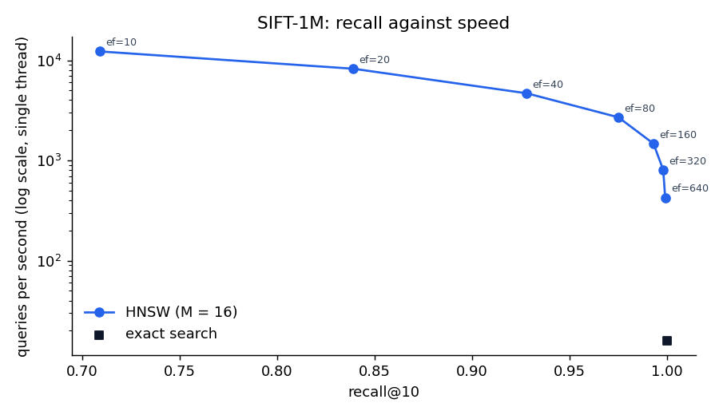

# vectordb

A vector database written from scratch in Java: an HNSW approximate nearest-neighbour index,
a write-ahead log for durability, an HTTP service, and leader–follower replication, measured
against exact search on standard ANN benchmarks.

It exists to answer, with numbers, the questions a production vector store has to answer:
how much recall do you give up for how much speed, what survives a crash, and what happens to
writes when a node dies.

> **Status:** milestones 1-5 of 6 done. On SIFT-1M (1,000,000 vectors) the HNSW index reaches
> recall@10 of 0.975 at 169x the speed of exact search, and 0.993 at 92x, on a single thread.
> Writes are logged before they are applied and survive killing the process; recovery from a
> snapshot is 368x faster than replaying the log. It runs as an HTTP service, in Docker, with
> searches on every core: 57,000 to 71,000 a second on 24 threads over 100,000 vectors.
> Replication is next.
> Benchmark numbers below come only from real runs.

## Build

Requires JDK 21 or newer. The Gradle wrapper downloads Gradle itself.

```bash
./gradlew build      # compile, run tests
./gradlew test       # tests only
./gradlew sweep      # recall and speed of HNSW against exact search
scripts/download_sift.sh   # SIFT-1M into data/sift (160 MB download)
./gradlew sift             # SIFT-1M benchmark, about 15 minutes; -Pn=100000 for a quick subset
./gradlew durability       # cost of logging and speed of recovery on 100,000 SIFT vectors
./gradlew concurrency      # search throughput by thread count, with a writer, and over HTTP
./gradlew run --args="--port 8080 --data vectordb-data"   # start the server
```

## Design

| Piece | Choice | Why |
|---|---|---|
| Exact search | `FlatIndex`: one packed `float[]`, bounded max-heap of size k | Ground truth for recall; the baseline HNSW must beat on latency |
| ANN index | `HnswIndex` (Malkov & Yashunin, 2018) | State of the art for in-memory ANN; the same family used in Lucene, FAISS and pgvector |
| Metrics | `L2` (squared), `COSINE`, `DOT`, all "smaller is closer" | One ordering rule for every index |
| Determinism | Seeded level assignment with saveable generator state, ties broken by id | Reproducible tests and benchmarks; replaying the same operations rebuilds the same graph |
| Deletes | Tombstones: a removed node stays linked but is never returned | Removing a node from an HNSW graph would break paths that run through it |
| Durability | Append-only WAL with a CRC32 and sequence number per record; snapshots written to a temporary file and renamed | No acknowledged write is lost in a crash, and recovery does not have to rebuild the graph from scratch |
| Concurrency | One writer at a time; a read-write lock around the graph, taken exclusively only for the change in memory | Searches run on every core and never wait for a log write, an fsync or a snapshot |
| Service | HTTP and JSON on the JDK's built-in server, a virtual thread per request, no dependencies | Anything can call it with `curl`; nothing to audit but this repository |
| Replication (M6) | WAL shipping from leader to followers | Simple, testable; Raft is the stretch goal |

## Milestones

| # | Weeks | Goal | Done when |
|---|---|---|---|
| 1 | 1 | **Exact baseline.** `Distance`, `FlatIndex`, `Recall`, CI on JDK 21 and 25 | ✅ tests green (CI runs on JDK 21 and 25) |
| 2 | 2–3 | **HNSW in memory.** Insert (Alg. 1), layer search (Alg. 2), neighbour heuristic (Alg. 4), k-NN search (Alg. 5) | ✅ recall@10 ≥ 0.90 test passing (0.993 at `efSearch` 100) |
| 3 | 4 | **Benchmarks.** Load SIFT-1M (`.fvecs`/`.ivecs`), recall-vs-QPS curve across `efSearch`, latency, build time and memory | ✅ SIFT-1M table and plot below. GloVe-100 and JMH distance kernels moved to the stretch goals |
| 4 | 5 | **Durability.** WAL (append, fsync policy, CRC), snapshot + replay, deletes via tombstones | ✅ `KillRecoveryTest` kills a writer process 16 times and recovers every acknowledged write. Power loss is not tested |
| 5 | 6 | **Service.** HTTP API (collections, upsert, search, delete), read–write locking, directory lock, Dockerfile | ✅ `docker run` and `curl` example below; CI builds the image, stops it, kills it and checks the data each time; `ConcurrencyTest` runs readers, a writer and snapshots together |
| 6 | 7–8 | **Replication.** Leader ships WAL to followers, follower catch-up, manual failover; Docker Compose cluster | Failure test: kill the leader, promote a follower, no acknowledged write lost |

Stretch: SIMD distance kernels with the Java Vector API (benchmarked with JMH), multi-threaded
builds, inserts that hold the exclusive lock only while linking, group commit for the log,
reclaiming removed vectors, GloVe-100 for angular distance,
product quantisation, Raft, and plugging this in as a retriever backend for
[rag-retrieval-bench](https://github.com/Agampal007/rag-retrieval-bench).

## Durability

`DurableIndex` wraps the HNSW index so that its contents survive a crash.

```java
try (DurableIndex index = DurableIndex.open(dir, () -> new HnswIndex(128, Distance.L2), SyncPolicy.EVERY_WRITE)) {
    index.add(42, vector);   // on the storage device before this returns
    index.upsert(42, other); // replaces it: one log record, so never half done
    index.remove(7);
    index.snapshot();        // optional: makes the next open fast
}
```

- **Write-ahead log.** Every add, upsert and remove is appended to `wal.log` before it is applied in
  memory. A record is its length, a CRC32, a sequence number and the operation. With
  `EVERY_WRITE` each record is fsynced before the call returns; with `MANUAL` the caller decides
  when to sync.
- **Snapshots.** `snapshot()` writes the whole index to a temporary file, fsyncs it, renames it
  over the old snapshot (an atomic step) and then empties the log.
- **Recovery.** Opening a directory loads the snapshot, if there is one, and replays the log
  records with a higher sequence number.
- **Deterministic replay.** Replay runs the same code as the original calls, and the snapshot
  stores the state of the generator that assigns graph levels. A recovered index is therefore the
  same graph, link for link, as one that never stopped. The tests check this directly, and it is
  what replication (milestone 6) will rely on.

What recovery does in each failure case, and the test that covers it:

| What happened | What recovery does | Covered by |
| --- | --- | --- |
| The last record was cut short | Truncates it; it was never acknowledged | `WriteAheadLogTest` cuts the last record at every byte |
| The file was extended but the data never arrived (zeros at the end) | Truncates the zeros | `WriteAheadLogTest` |
| A checksum fails before the last record | Refuses to open and leaves the file untouched, because truncating there would drop acknowledged writes | `WriteAheadLogTest`, `DurableIndexTest` |
| The process died while writing a snapshot | Discards the half-written temporary file and uses the previous snapshot plus the log | `DurableIndexTest`; about a third of the kills in `KillRecoveryTest` land here (5 or 6 of 16 in the runs so far) |
| The process died after the snapshot was renamed but before the log was emptied | Uses sequence numbers to skip the records the snapshot already holds | `DurableIndexTest` |
| The snapshot fails its checksum or is cut short | Refuses to open | `DurableIndexTest` |
| The writer process was killed at a random moment | No acknowledged write is missing and the graph equals an uninterrupted build | `KillRecoveryTest`: 16 kills of a real JVM, each continuing from the last |

### What it costs

Output of `./gradlew durability` on the first 100,000 SIFT vectors (`results/durability-100k.txt`),
same laptop and settings as the SIFT-1M run below:

| Step | Time | Notes |
| --- | --- | --- |
| Build in memory | 32.7 s | no durability |
| Build with every write logged, one fsync at the end | 33.2 s | log is 51 MB |
| Recover by replaying the log | 33.3 s | rebuilds the graph insert by insert |
| Write a snapshot | 0.11 s | 58 MB, includes the fsync |
| Recover from the snapshot | 0.09 s | 368x faster than replay |

- **Logging is cheap; fsync is not.** Appending every write to the log added 0.5 s to a 33 s
  build. Forcing each record to the device is the real cost: the log managed 1,771 appends per
  second with an fsync per record against 257,526 without. That is about 0.56 ms per fsync, more
  than the 0.33 ms an insert takes at this size, so `EVERY_WRITE` would roughly triple the build
  time (an estimate from these two figures, not a measured run). Group commit, one fsync for many
  writers, is the usual fix and is a stretch goal.
- **Replay costs as much as the original build**, because it re-inserts every vector. A snapshot
  stores the finished graph, so loading it took 0.09 s, and searches on the loaded index returned
  exactly the results of the in-memory build.

### What is not covered

- **Power loss is not tested.** Killing a process does not test fsync, because the operating
  system still flushes its cache afterwards. Whether an fsync really reaches the disk also depends
  on the device.
- **A damaged final record is dropped silently.** It cannot be told apart from a torn write. The
  same goes for a record whose damaged length field makes it appear to run past the end of the file.
- **One process per directory.** A second opener is refused (see the service section). The lock
  is advisory: it stops this program, not another one writing to the same files.
- **Removed vectors keep their space**, in memory and in snapshots, until the index is rebuilt.
- **A snapshot rewrites the whole index.** Its cost grows with the index, not with what changed.
- **On Windows the snapshot rename is atomic but not fsynced**, because a directory cannot be
  opened for fsync there.

## Service

```bash
./gradlew run --args="--port 8080 --data vectordb-data"
```

or, in Docker, with the data in a named volume:

```bash
docker build -t vectordb .
docker run -p 8080:8080 -v vectordb-data:/data vectordb
```

Then, from another terminal:

```bash
curl -X PUT localhost:8080/collections/demo -d '{"dimension": 4, "distance": "l2"}'

curl -X POST localhost:8080/collections/demo/vectors -d '{"vectors": [
    {"id": 1, "vector": [1, 0, 0, 0]},
    {"id": 2, "vector": [0, 1, 0, 0]},
    {"id": 3, "vector": [0, 0, 1, 0]}]}'

curl -X POST localhost:8080/collections/demo/search -d '{"vector": [0.5, 1, 0, 0], "k": 2}'
# {"results":[{"id":2,"distance":0.25},{"id":1,"distance":1.25}]}
```

`scripts/smoke_test.sh` runs these requests and checks the answers.

| Request | Body | Answer |
| --- | --- | --- |
| `GET /health` | | `{"status":"ok"}` |
| `GET /collections` | | every collection with its settings and size |
| `PUT /collections/{name}` | `dimension`; optional `distance` (`l2`, `cosine`, `dot`), `m`, `efConstruction`, `efSearch` | 201 and the collection; 409 if the name is taken |
| `GET /collections/{name}` | | settings and size |
| `DELETE /collections/{name}` | | closes the collection and deletes its files |
| `POST /collections/{name}/vectors` | `vectors`: a list of `{"id", "vector"}` | `{"upserted": n, "replaced": r}` |
| `GET /collections/{name}/vectors/{id}` | | the stored vector, or 404 |
| `DELETE /collections/{name}/vectors/{id}` | | `{"removed": true}`, or 404 |
| `POST /collections/{name}/search` | `vector`; optional `k` (default 10) and `efSearch` | `results`: `{"id", "distance"}`, closest first |
| `POST /collections/{name}/snapshot` | | writes a snapshot now |

Errors are `{"error": "..."}` with status 400 (bad input), 404, 405, 409 or 413 (body over
`--max-body-mb`, 32 MB by default). Ids are 64-bit integers and are never passed through a
floating-point number.

- **A write is answered after it is durable.** The request's records go to the log, one fsync
  covers the whole request, and only then is the answer sent. `--sync none` skips the fsync: an
  answered write then survives a crash of the server but not of the machine.
- **A bad entry rejects the whole request.** Every vector in a request is checked before any of
  them is written.
- **Upsert is one log record.** Replacing a vector by removing and re-adding it would be two
  records, and a crash between them would leave the id with nothing. `UpsertTest` cuts the record
  short and checks that the old vector is still there.
- **Recovery time is bounded.** A collection is snapshotted when its log passes
  `--snapshot-log-mb` (64 MB by default), and on a clean shutdown, so a restart never replays more
  than that.
- **One process per data directory.** The server takes an operating-system lock on a `LOCK` file
  in the data directory and in each collection. A second server on the same directory is refused
  at start-up instead of corrupting the log. The operating system drops the lock when the process
  dies, so a crash never leaves the directory locked; `DirectoryLockTest` kills the holder to
  check that.
- **Collection names** are 1 to 64 letters, digits, `-` or `_`. A name becomes a directory name,
  so nothing else is accepted.

### Concurrency

`DurableIndex` is safe to call from any number of threads. It uses two locks:

- A **writer lock** admits one writer at a time and is held across the log append and the change
  in memory. Operations therefore reach the log in the order they were applied, which is what
  makes replay rebuild the same graph.
- A **graph lock**, a read-write lock around the in-memory index. Searches share it. A writer
  takes it exclusively only for the change in memory, after its log append has returned.

So a search can wait for an insert into the graph, but never for the disk: not for a log append,
not for an fsync, and not for a snapshot, which only reads the index. Each search also borrows
its own scratch space, where the single-threaded index shared one.

What the tests check:

| Guarantee | Test |
| --- | --- |
| Eight threads searching at once get exactly the results one thread gets | `ConcurrencyTest` |
| While a writer adds and removes and another thread snapshots, no search returns a vector whose removal had already returned, and the final graph equals a single-threaded build, in memory and after reopening | `ConcurrencyTest` |
| With four writers at once, replaying the log rebuilds the graph that was in memory | `ConcurrencyTest` |
| A second opener is refused, in the same process and from another one, and is admitted once the holder is killed | `DirectoryLockTest` |
| Search results over HTTP equal the results of calling the index directly | `VectorDbServerTest` |
| 36 malformed or misdirected requests are refused and change nothing on disk | `VectorDbServerTest` |
| Data survives a server restart; concurrent clients reading and writing all succeed | `VectorDbServerTest` |
| In Docker: after `docker stop` the snapshot is loaded and nothing is replayed; after `docker kill` the log is replayed; the data is intact both times | the `docker` job in CI |

The three `ConcurrencyTest` checks were each seen to fail with the lock they cover removed:
sharing one scratch space between searches, returning removed vectors, and dropping the writer
lock.

### What it measures

Output of `./gradlew concurrency` on the first 100,000 SIFT vectors
(`results/concurrency-100k.txt`), `efSearch` 100, `k` 10, on the same laptop as the other
benchmarks (8 performance and 16 efficiency cores, no hyper-threading). Each row starts from a
copy of the same snapshot and runs for 4 seconds after 1 second of warm-up. The writer adds new
vectors one at a time and fsyncs each.

| Search threads | Searches/s, no writer | Per thread | Searches/s, one writer | Writes/s (fsync each) |
| --- | --- | --- | --- | --- |
| 1 | 2,053 | 2,053 | 896 | 411 |
| 2 | 4,132 | 2,066 | 1,905 | 400 |
| 4 | 9,595 | 2,399 | 4,400 | 461 |
| 8 | 21,611 | 2,701 | 7,850 | 374 |
| 16 | 48,204 | 3,013 | 9,492 | 233 |
| 24 | 69,981 | 2,916 | 38,933 | 252 |

- **Searches use every core.** Throughput went from 2,053 searches a second on one thread to
  69,981 on 24. Two earlier runs gave 56,575 and 70,884 at 24 threads, so read that figure as
  57,000 to 71,000.
- **No speed-up factor is quoted, because the one-thread row is not a clean baseline.**
  Throughput per thread rises with the thread count, which the code cannot cause. The likely
  reason is that the operating system decides which kind of core and which clock speed a lone
  thread gets; that was not verified.
- **One writer costs searches more than half their throughput at most thread counts.** At 100,000
  vectors an insert takes about 0.33 ms, and it needs the graph to itself: searches already
  running have to finish first, and new ones queue behind the writer. With 16 search threads that
  left 9,492 searches a second against 48,204 with no writer. The known fixes are to search for
  the new vector's neighbours under the shared lock and take the exclusive lock only to link it
  in, or per-node locks as hnswlib uses. Neither is done.
- **Searches slow the writer down too**: 411 inserts a second next to one search thread, 252 next
  to 24.

The same searches through the HTTP API on localhost, with `GET /health`, which does no work, as
the baseline:

| Request | Clients | Requests/s | Median latency | 99th percentile |
| --- | --- | --- | --- | --- |
| `GET /health` | 1 | 444 | 2.04 ms | 5.32 ms |
| `POST search` | 1 | 313 | 2.81 ms | 6.79 ms |
| `GET /health` | 8 | 6,123 | 1.28 ms | 2.07 ms |
| `POST search` | 8 | 4,466 | 1.76 ms | 2.94 ms |
| `GET /health` | 24 | 7,173 | 3.29 ms | 5.07 ms |
| `POST search` | 24 | 6,114 | 3.83 ms | 5.97 ms |

- **The HTTP layer, not the index, sets the latency here.** A request that does nothing takes
  1.3 to 3.3 ms, and a search adds 0.5 to 0.8 ms to that. With 8 clients the service answered 4,466
  searches a second, where 8 threads calling the index directly managed 21,611.
- This was measured on Windows with the JDK's built-in server and client. It has not been measured
  on Linux or with another client, so it says little about the cost elsewhere.

### What the service does not do

- **No authentication and no TLS.** It listens on `127.0.0.1` unless `--host` says otherwise. The
  Docker image listens on all of the container's interfaces, so publish the port only where the
  network is trusted, or put a proxy in front of it.
- **A request is not atomic.** Each vector is its own log record. If the server dies part-way
  through a request, the vectors already logged may be kept, and the client, which got no answer,
  has to send the request again. Sending it again is safe, because upsert replaces.
- **The Docker image has only been run in CI**, on Linux. Docker is not installed on the machine
  the rest of this was developed on.
- **The request that crosses the log limit pays for the snapshot** (0.11 s at 100,000 vectors),
  and other writers wait for it. Searches do not.
- **Vectors only.** No metadata, no filtering, no paging through a collection.
- **One node.** Replication is milestone 6.

## Benchmarks

### SIFT-1M

[SIFT-1M](http://corpus-texmex.irisa.fr/) is a standard ANN benchmark: 1,000,000 128-dimensional
image descriptors, 10,000 query vectors, and the exact 100 nearest neighbours of each query. Recall
is measured against those published neighbours. Exact search scores 1.000 against them, which also
checks the file reader and the distance code.

Run on a laptop (Intel Core Ultra 9 275HX, 64 GB RAM, JDK 25), single-threaded for both building
and querying, `M` = 16, `efConstruction` = 200, k = 10. Full output: `results/sift-1m.txt`.

- **Build:** 742 s (12.4 minutes) for 1,000,000 inserts.
- **Heap:** 1.52 GB with both the HNSW index and the exact index loaded (each holds its own copy of
  the 512 MB of vectors).

| Index | efSearch | Recall@10 | Queries/s | p50 latency (ms) | p99 latency (ms) |
| --- | --- | --- | --- | --- | --- |
| Exact (FlatIndex) | - | 1.000 | 16 | 56.9 | 94.4 |
| HNSW | 10 | 0.709 | 12,254 | 0.076 | 0.179 |
| HNSW | 20 | 0.839 | 8,232 | 0.116 | 0.226 |
| HNSW | 40 | 0.928 | 4,681 | 0.207 | 0.422 |
| HNSW | 80 | 0.975 | 2,697 | 0.363 | 0.644 |
| HNSW | 160 | 0.993 | 1,473 | 0.671 | 1.210 |
| HNSW | 320 | 0.998 | 806 | 1.235 | 2.194 |
| HNSW | 640 | 0.999 | 426 | 2.302 | 4.397 |



What it shows:

- **At a million vectors the graph pays off.** At recall 0.975 HNSW answers 169 times as many
  queries per second as a full scan (2,697 against 16), and at 0.993 it is still 92 times faster.
  The p99 latency at `efSearch` 80 is 0.64 ms against 94 ms. At 10,000 vectors (below) the same
  index was only 1.7-3.2 times faster, because a small scan is cheap.
- **The last per cent of recall is the expensive part.** Going from 0.975 to 0.993 halves the
  throughput, and 0.998 to 0.999 halves it again.
- **This is a plain Java implementation.** Distances are scalar loops (no SIMD), and the build is
  single-threaded, so optimised C++ libraries are faster. The stretch goals target both.

Caveats: one run on one machine; timings from `System.nanoTime()` around each query after a
warm-up, not JMH. Exact-search speed is timed on the first 200 queries; HNSW on all 10,000.

### First check: 10,000 random vectors

Output of `./gradlew sweep`: 10,000 uniform random 32-dimensional vectors, 200 queries, k = 10,
L2, `M` = 16, `efConstruction` = 200. Single-threaded on a laptop with an Intel Core Ultra 9 275HX,
JDK 25. HNSW build took 1.9 s.

| Index | efSearch | Recall@10 | Queries/s |
| --- | --- | --- | --- |
| Exact (FlatIndex) | - | 1.000 | 6,591 |
| HNSW | 10 | 0.596 | 98,037 |
| HNSW | 20 | 0.786 | 50,512 |
| HNSW | 50 | 0.945 | 21,292 |
| HNSW | 100 | 0.993 | 11,354 |
| HNSW | 200 | 1.000 | 5,691 |

What it shows:

- **`efSearch` is the recall/speed dial.** Each doubling roughly halves throughput, and recall
  climbs from 0.596 to 1.000 across the range.
- **At this size HNSW wins only modestly.** At recall 0.945 it is 3.2x faster than a full scan;
  at 0.993, 1.7x. A scan of 10,000 vectors is cheap, so the gap grows with the dataset (see
  SIFT-1M above).
- **Random data is a hard case.** Uniform vectors in 32 dimensions have no clusters for the graph
  to exploit, so real embeddings usually reach the same recall at a lower `efSearch`.

Caveats: one dataset and size, one seed, timings from `System.nanoTime()` after a warm-up rather
than JMH, and the numbers vary by a few per cent between runs.

### Known limitation: many exact duplicates

When hundreds of vectors are identical, the early copies fill their link lists and ties keep the
older links, so later copies get no inbound links. In a test with 300 identical vectors, 34 were
reachable. Search still returns exact matches, but not every copy. Deduplicate upstream if this
matters.

## Layout

```
src/main/java/io/github/agampal007/vectordb/
  Distance.java      distance metrics
  VectorIndex.java   index interface
  SearchResult.java  (id, distance) hit
  FlatIndex.java     exact search
  HnswIndex.java     HNSW graph index
  eval/Recall.java   recall@k
  DurableIndex.java  HNSW index with a write-ahead log, snapshots, recovery and locking
  DirectoryLock.java one process per directory
  Snapshot.java      checksummed, atomically replaced copy of the index on disk
  Lcg.java           java.util.Random's generator with saveable state
  wal/               WriteAheadLog: checksummed records, torn-write recovery
  io/VecsFiles.java  .fvecs / .ivecs readers for ANN benchmark data
  server/            VectorDbServer (HTTP API), CollectionStore, Json, Main
src/test/java/...    unit tests, KillRecoveryTest (kills a writer process), ConcurrencyTest,
                     RandomDataSweep (./gradlew sweep), SiftBenchmark (./gradlew sift),
                     DurabilityBenchmark (./gradlew durability), ConcurrencyBenchmark
                     (./gradlew concurrency)
Dockerfile           two-stage build; runs the server as an unprivileged user
scripts/             SIFT-1M download, recall/QPS plot, smoke_test.sh (curl against a server)
results/, docs/      saved benchmark output and plots
```

## Licence

MIT
